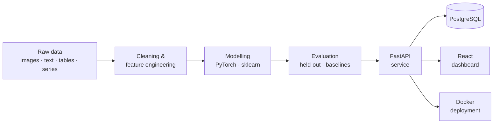

---

## 👤 About

I'm a **data scientist and ML engineer with 4 years of applied experience**. I solve problems on images, text, tables and time series, and I build the whole path myself: data pipelines, modelling, an API, a database and a UI.

I trained as an aerospace engineer (M.Sc., GPA 3.77/4) and I'm used to models of physical systems with noisy, incomplete data. I care about **honest evaluation**: held-out test sets, spatially separated splits, and comparison against published baselines.

<table>
<tr>
<td align="center" width="25%"><h3>4 yrs</h3>applied ML in production teams</td>
<td align="center" width="25%"><h3>6+</h3>models shipped into a live platform</td>
<td align="center" width="25%"><h3>4</h3>data modalities vision · text · tabular · time series</td>
<td align="center" width="25%"><h3>E2E</h3>model → API → DB → UI</td>
</tr>
</table>

---

## 🧰 Skills

| | |
|---|---|
| **Modelling** | PyTorch · TensorFlow · Keras · scikit-learn · Transformers · Optuna |
| **Data** | Python · NumPy · Pandas · SciPy · SQL / PostgreSQL |
| **Statistics & evaluation** | Cross-validation · spatial hold-out · F1 / IoU / PQ · baselines · error analysis |
| **Engineering** | FastAPI · React · Docker · Linux · Git |
| **Visualisation** | Matplotlib · Seaborn · Plotly · Streamlit |

---

## 🧭 What I can solve

| 🖼️ Computer vision | 📝 NLP | 📊 Tabular & forecasting | 🧪 Bio & finance |
|---|---|---|---|
| Segmentation, super-resolution, multi-task regression | Text classification with BERT, vision-language models | Feature engineering, time-series transformers, forecast fusion | Drug-synergy prediction, real-time FX prediction |

---

## 🚀 Featured work

> All scores are measured on held-out data.

### 🛰️ Field boundary segmentation (computer vision)
U-Net with an EfficientNet-B7 backbone, a 4-class output and watershed post-processing, tuned with Optuna.

| Model | Pixel IoU | Panoptic quality |
|---|:-:|:-:|
| **Mine** | **0.858** | **0.223** |
| FTW (published baseline) | 0.752 | 0.176 |
| Delineate-Anything v2 | 0.677 | 0.157 |

Adapting the model to a new region meant retraining **580 of 67 M parameters** on 1,000 tiles.

### 🌱 Irrigation & land-cover classification (time series, transformers)
A pretrained Presto transformer fine-tuned on monthly multi-sensor series.

| Task | Result |
|---|---|
| Irrigation (2 classes) | Accuracy **0.82**, F1 0.84 / 0.80 |
| Land cover (11 classes, 2.39 M unseen test pixels) | Accuracy **0.825**, macro-F1 **0.786** |
| Crops (11 classes) | F1 **0.75** |
| Area vs. official statistics | **29%** error vs 134% for an embedding baseline |

### 🔍 8× super-resolution (SwinIR)
Reconstructs 1.25 m imagery from free 10 m Sentinel-2 scenes.

### 🍽️ dish2calories: nutrition from a photo
Re-implemented Google's Nutrition5k with a lighter EfficientNet-B0. It beats the baseline on calories (**MAE 67.7 vs 70.6**) and mass (**28.6 vs 40.4**).

### 🌦️ Multimodel weather forecasting
Neural fusion of **GraphCast, FuXi and FCN3** for regional medium-range forecasts.

### 📝 Crop disease diagnosis (NLP and multimodal)
A BERT classifier on symptom text (**90%+ accuracy**) and a vision-language model that aligns visual symptoms with disease descriptions.

---

## 🏗️ How I ship: end to end

Features I've built around models include a results cache, so repeated questions are never recomputed, plus run queues with progress, confidence scores on predictions, and CSV, GeoTIFF and GeoPackage exports.

---

## 💼 Experience

| | |
|---|---|
| **Machine Learning Engineer**, FANAP Advanced Technologies Lab (ZLab) · *2022 → now* | Models for classification, segmentation, super-resolution and forecasting, delivered into a production analytics platform. |
| **Course Instructor**, Faradars · *2022* | Designed and taught a signal-filtering course (Kalman, Wiener, adaptive filters, CNNs), rated **4.4/5**. |

## 🎓 Education

- **M.Sc. Flight Dynamics & Control**, Amirkabir University of Technology, GPA **3.77/4**
- **B.Sc. Aerospace Engineering**, Islamic Azad University

## 📚 Publications

- *Optimization and Design of General Aviation Aircraft Wings Using NSGA-II*, Journal of Aircraft Engineering, 2021 · [DOI](https://doi.org/10.22034/joae.2021.303370.1055)
- *Modeling the Ideal Pathway of Plant-Loaded Projectiles for Effective Aerial Reforestation*, 2024
- *A Review on Airborne Collision Avoidance Systems*, 2022

---

### Let's build something

